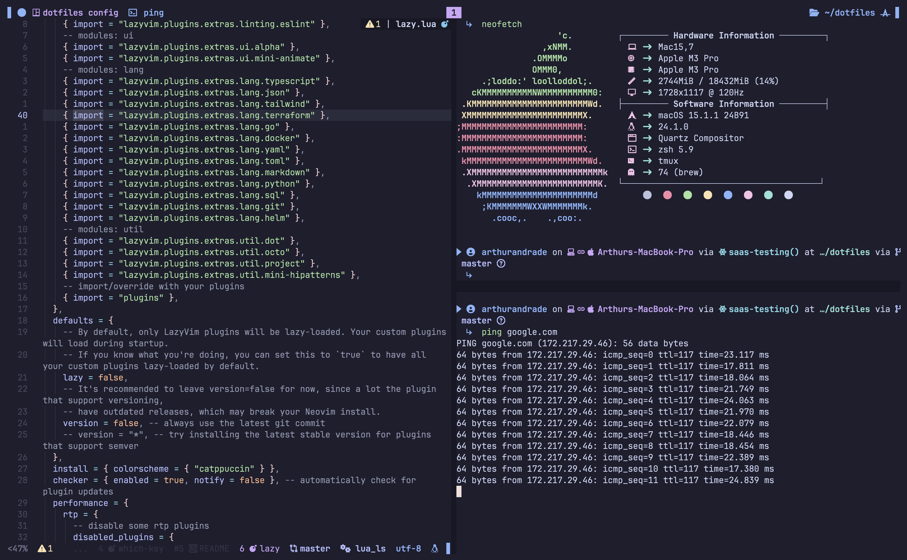

# 🌟 My Dotfiles

Welcome to my dotfiles repository!
This setup is built for a **zsh** shell environment on Linux Mint, with carefully tuned configurations for **tmux** and **sesh** to enhance productivity and developer happiness.

This setup is built for myself and is just a source of inspiration. I'm ok with you copying everything, but I'll probably not be giving support to all platforms and shells.

---

## ✨ Preview

Here's a sneak peek of what your terminal could look like after applying these dotfiles:

**Terminal (zsh + tmux):**


---

## 🚀 Getting Started

Follow these steps to reproduce this setup on your own machine. The package setup targets Ubuntu 24.04-based systems such as Linux Mint 22.

### Prerequisites

#### Git, GNU Stow and curl
```bash
sudo apt-get update
sudo apt-get install git stow curl
```

#### Homebrew
```bash
/bin/bash -c "$(curl -fsSL https://raw.githubusercontent.com/Homebrew/install/HEAD/install.sh)"
```

---

### 1️⃣ Clone the Repository

```bash
git clone https://github.com/MBrunoS/dotfiles.git ~/dotfiles
cd ~/dotfiles
```

---

### 2️⃣ Backup Your Existing Configuration

If you have existing configurations for zsh or tmux, back them up first:

```bash
mv ~/.zshrc ~/.zshrc.backup
mv ~/.zshenv ~/.zshenv.backup
mv ~/.config/tmux ~/.config/tmux.backup
```

---

### 3️⃣ Use GNU Stow to Apply Dotfiles

This repository uses [GNU Stow](https://www.gnu.org/software/stow/) to symlink the dotfiles into your home directory:

```bash
stow .
```

The repository is a single Stow package that mirrors your home directory:

- `~/dotfiles/.zshrc` → `~/.zshrc`
- `~/dotfiles/.config/tmux` → `~/.config/tmux`

Everything listed in `.stow-local-ignore` stays out of your home directory.

---

### 4️⃣ Install Packages

```bash
~/dotfiles/packages/install
```

This adds the third-party apt repositories, installs everything on the package lists, and installs Claude Code and pnpm if they're missing. It's safe to re-run, and it never upgrades what's already installed.

---

### 5️⃣ Switch to zsh (if not already your default shell)

```bash
chsh -s $(which zsh)
```

Log out and back in to apply the changes.

---

## 📦 Managing Packages

Packages are installed explicitly, never at shell startup. apt is preferred because Mint's updates keep it current; Homebrew only covers what apt can't provide or only has in a version too old for this setup.

| File | Contents |
|---|---|
| `packages/apt/packages.txt` | apt packages |
| `packages/apt/sources`, `packages/apt/keys` | Third-party apt repositories and their public keys |
| `packages/Brewfile` | Homebrew formulae and casks |

- **Add a tool:** add it to a list, then run `~/dotfiles/packages/install`.
- **Remove a tool:** delete it from the list and uninstall it with `sudo apt remove` or `brew uninstall`.
- **Update:** use Mint's Update Manager for apt packages and `brew upgrade` for Homebrew.

Tools outside these lists, such as Godot, the Android SDK, Docker and Flatpak apps, are installed by hand.

---

## 🖥️ Using tmux and sesh

Opening a terminal shows the [sesh](https://github.com/joshmedeski/sesh) picker, with your preset sessions, tmux sessions and zoxide folders. Pick one to attach to it or create it, or press `Esc` for a plain shell. Preset sessions live in `.config/sesh/sesh.toml`.

The tmux prefix is `Ctrl+a`.

| Keys | Action |
|---|---|
| `prefix` + `f` | Open the sesh picker |
| `prefix` + `.` | Rename the session after the current folder |
| `prefix` + `\` / `prefix` + `-` | Split the pane horizontally / vertically |
| `prefix` + `h` `j` `k` `l` | Move between panes |
| `Alt+Shift+h` / `Alt+Shift+l` | Previous / next window |
| `prefix` + `r` | Reload the tmux config |
| Mouse selection | Copy to the system clipboard |

---

## 🛠️ Customizing the Dotfiles

Feel free to modify the configurations to suit your needs!

- `.zshrc` loads the modules in `.zsh`, and everything in `.zsh/programs`.
- `.zsh/work` is for private files: they're loaded automatically and ignored by Git.
- `.config` holds the configuration for each tool, including tmux and its status bar themes.

---

## 💡 Tips for Beginners

- **Start Small**: Focus on one tool at a time (e.g., zsh first, then tmux).
- **Experiment Safely**: Use version control (like Git) to track changes to your dotfiles.
- **Learn and Adapt**: Look into the comments in each config file for explanations and tips.

---

## 📸 Showcase Your Setup

Once you've configured your environment, feel free to share your own screenshots! Raise an issue or start a discussion in this repo to show off your tweaks.

---

## 🔗 Resources

- [GNU Stow Documentation](https://www.gnu.org/software/stow/)
- [sesh](https://github.com/joshmedeski/sesh)
- [zinit](https://github.com/zdharma-continuum/zinit)
- [tmux Documentation](https://github.com/tmux/tmux/wiki)

---

## 🙌 Contributions

PRs are welcome! If you spot improvements, open an issue or submit a pull request.

---

## 📜 License

This repository is licensed under the MIT License. Feel free to use, modify, and share.
